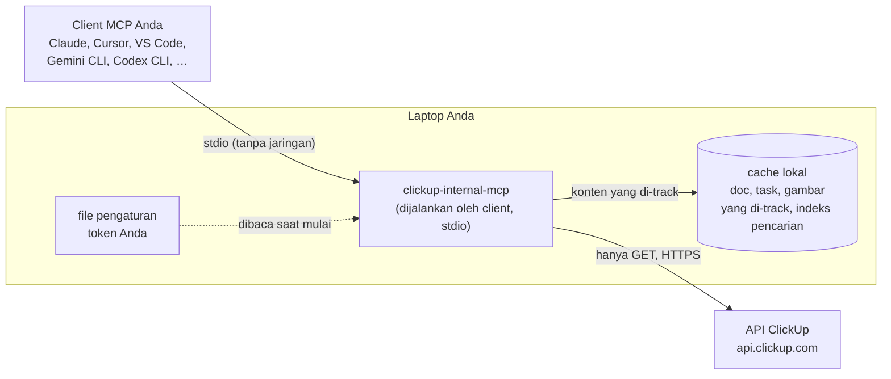

# clickup-internal-mcp

[English](README.md) | **Bahasa Indonesia**

Server [MCP](https://modelcontextprotocol.io) yang hanya membaca, supaya asisten AI Anda bisa membaca
**workspace ClickUp memakai token personal Anda sendiri**, ketika ClickUp MCP resmi tidak tersedia
untuk Anda. Bisa dipakai di client MCP apa pun yang menjalankan server lokal: Claude Desktop, Claude
Code, Cursor, Windsurf, VS Code (Copilot), Gemini CLI, Codex CLI, dan lainnya. Dibuat terutama untuk
**mengumpulkan requirement** dari ClickUp Docs dan task, dan cukup umum untuk pencarian ClickUp apa
pun.



**Cara kerjanya, dalam bahasa sederhana:**

1. **Anda bertanya ke asisten**, misalnya "baca doc ini dan daftarkan requirement-nya", sambil
   menempelkan link ClickUp. Asisten memanggil clickup-internal-mcp.
2. **Server berjalan di laptop Anda sendiri.** Client MCP menjalankannya sebagai program kecil di
   latar belakang dan berbicara langsung dengannya; tidak ada port jaringan yang dibuka di sisi Anda.
3. **Server bertanya ke ClickUp memakai token Anda**, jadi yang terlihat persis sama dengan yang bisa
   Anda lihat di ClickUp, tidak lebih. Server hanya *membaca*: tidak ada kode di dalamnya yang bisa
   membuat, mengubah, atau menghapus apa pun di ClickUp.
4. **Yang Anda pilih untuk di-track disimpan di laptop**, dalam database lokal kecil dengan indeks
   pencarian. Pertanyaan berikutnya dijawab dalam hitungan milidetik tanpa bertanya ke ClickUp lagi,
   dan Anda bisa melihat apa yang berubah sejak minggu lalu. Yang tidak di-track dibaca langsung dan
   dilupakan setelah beberapa menit.
5. **Mockup dan diagram juga ditangani.** Gambar di doc yang di-track di-download sekali. Asisten
   melihat tiap gambar sekali dan menyimpan deskripsi singkatnya, sehingga pembacaan berikutnya cukup
   teks dan hemat.

- **Dibuat untuk requirement.** Baca doc per halaman dengan gambar dan embed-nya terdaftar, ambil
  task beserta acceptance criteria, custom field, dan komentarnya, cari di semua yang Anda track, dan
  lihat apa yang berubah di requirement sejak terakhir Anda cek.
- **Hanya membaca dari ClickUp, sejak desain.** Satu-satunya kode yang berbicara dengan ClickUp hanya
  mengirim request `GET`. Token Anda hanya dikirim ke host milik ClickUp sendiri.
- **Cepat.** Satu halaman dari cache terbaca dalam sekitar 2 ms, pencarian atas 2.000 halaman sekitar
  7 ms (diukur, lihat [Seberapa Cepat](#seberapa-cepat)). Pembacaan langsung memakan waktu sebesar
  waktu ClickUp, biasanya 100–500 ms.
- **Tenang.** Default-nya maksimal 8 request bersamaan dan 300 per menit, jauh di bawah limit
  ClickUp, sehingga aktivitas token Anda terlihat seperti orang membaca, bukan crawler.
- **Jawaban ringkas.** Setiap jawaban punya batas karakter dan turun tingkat detailnya sebelum ada
  yang dipotong, dengan cursor untuk sisanya.
- **Data di disk seminimal mungkin.** Hanya yang Anda track yang disimpan, di folder user Anda, dan
  satu perintah menghapus semuanya.

## Daftar Isi

- [Tools](#tools)
- [Seberapa Cepat](#seberapa-cepat)
- [Mulai Cepat](#mulai-cepat)
- [Untuk Rekan Tim yang Tidak Menulis Kode](#untuk-rekan-tim-yang-tidak-menulis-kode)
- [Hubungkan Client MCP Anda](#hubungkan-client-mcp-anda)
- [Mengumpulkan Requirement](#mengumpulkan-requirement)
- [Konfigurasi](#konfigurasi)
- [Data dan Privasi](#data-dan-privasi)
- [Model Keamanan](#model-keamanan)
- [Perintah](#perintah)
- [Troubleshooting](#troubleshooting)
- [Batasan](#batasan)
- [Pengembangan](#pengembangan)
- [Versioning](#versioning)
- [Tips](#tips)

## Tools

Sembilan tool. Jawaban berupa teks biasa, dan setiap baris diawali referensi yang bisa diteruskan ke
tool berikutnya. Semua tool juga menerima URL ClickUp dari host `*.clickup.com` mana pun (termasuk
host perusahaan seperti `perusahaananda.clickup.com`), jadi link yang ditempel tidak perlu ditelusuri
dulu.

| Tool | Dipakai untuk | Contoh input |
| ---- | ------------- | ------------ |
| `browse` | Menelusuri workspace: daftar space, lalu folder, list, dan doc di sebuah space; isi sebuah folder atau list. | `{"target": "space:90180123456"}` |
| `read_doc` | Membaca doc: outline halaman, satu halaman, atau semua halaman, dalam Markdown. Gambar muncul dengan catatannya; Figma, whiteboard, dan embed lain didaftar. | `{"doc": "https://app.clickup.com/9018…/v/dc/8cdu22c-13133/8cdu22c-4321"}` |
| `read_task` | Membaca satu task lengkap: status, orang, tanggal, deskripsi, custom field, subtask, lampiran, dan komentar. | `{"task": "task:ABC-123"}` |
| `list_tasks` | Mendaftar task di list, folder, atau space; filter status, assignee (`me`), tag, update terakhir, dan due date. | `{"in": "list:901812345678", "assignee": "me", "updated_since": "7d"}` |
| `search` | Mencari kata di semua yang Anda track: halaman doc, task, dan komentar, judul diprioritaskan. | `{"query": "checkout shipping", "kinds": ["docs"]}` |
| `track` | Memilih apa yang disimpan lokal: tambah, hapus, lihat daftar, atau sync doc, list, folder, atau space. | `{"action": "add", "target": "https://app.clickup.com/9018…/v/dc/8cdu22c-13133"}` |
| `changes` | Melihat apa yang berubah di konten yang di-track sejak terakhir dicek atau sejak tanggal tertentu: diff halaman dan event task. | `{"since": "7d"}` |
| `view_image` | Menampilkan satu gambar (mockup, diagram) ke asisten. | `{"image": "img:3f2a9c1b7d4e"}` |
| `note_image` | Menyimpan deskripsi gambar dari asisten; pembacaan berikutnya mencetak catatan ini, bukan gambarnya. | `{"image": "img:3f2a9c1b7d4e", "note": "Form checkout: …"}` |

`track` dan `note_image` hanya menulis ke cache lokal; tidak ada yang berubah di ClickUp.

Sesi requirement biasanya seperti ini:

```text
Anda:       Baca https://app.clickup.com/…/v/dc/8cdu22c-13133 dan daftarkan requirement-nya.
Asisten   → read_doc {"doc": "https://app.clickup.com/…/v/dc/8cdu22c-13133"}
            Doc: Checkout Requirements (doc:8cdu22c-13133) · live read · by bob · updated 5h ago · 6 pages
            Pages:
              doc:8cdu22c-13133/page:8cdu22c-4321  Overview (2,140 chars, 1 image)
              doc:8cdu22c-13133/page:8cdu22c-4322  Limits (860 chars)
              …
Anda:       Track doc ini, lalu deskripsikan mockup-nya.
Asisten   → track {"action": "add", "target": "doc:8cdu22c-13133"}
            Synced: 1 doc, 0 page changes, 0 tasks updated, 4 images.
Asisten   → view_image {"image": "img:3f2a9c1b7d4e"}  →  note_image {…}
Anda:       Acceptance criteria mana yang belum ada di task Sprint 42?
Asisten   → list_tasks {"in": "list:901812345678"}  →  read_task {"task": "task:ABC-123"}  →  …
Minggu depan: Apa yang berubah di requirement?
Asisten   → changes {}
            Docs:
              doc:8cdu22c-13133/page:8cdu22c-4322  Checkout Requirements › Limits · changed 2d ago (+3 −1)
                - Maksimal 10 barang per pesanan pelanggan.
                + Maksimal 20 barang per pesanan pelanggan.
```

Apa yang dikembalikan setiap tool, beserta semua argumennya: [docs/tools.md](docs/tools.md).

## Seberapa Cepat

Diukur dengan `bun run bench` di laptop Apple silicon (Bun 1.4.4), lewat client dan server MCP
sungguhan, terhadap API ClickUp palsu (jadi waktu ClickUp sendiri tidak termasuk). Tabel lengkap:
[docs/benchmarks.md](docs/benchmarks.md).

| Kasus | Doc 2.000 halaman, p95 | Doc 10.000 halaman, p95 |
| ----- | ---------------------- | ----------------------- |
| `read_doc` satu halaman dari cache | 2,0 ms | 7,7 ms |
| `read_doc` outline dari cache | 3,6 ms | 14,3 ms |
| `search`, dua kata | 7,5 ms | 50,9 ms |
| Sync pertama seluruh doc | 251 ms | 5,4 detik |

Pembacaan langsung ditambah waktu ClickUp, biasanya 100–500 ms per panggilan; pembacaan berulang
dalam beberapa menit diambil dari memori.

## Mulai Cepat

### 1. Kebutuhan

|  | Mac | Windows |
| - | --- | ------- |
| Runtime | [Bun](https://bun.sh) 1.4.4+: `brew install oven-sh/bun/bun` | Bun (`powershell -c "irm bun.sh/install.ps1 \| iex"`), atau **Node.js 22.18+** kalau Bun tidak diizinkan |
| Tidak boleh install runtime? | Pakai [executable satu file](#untuk-rekan-tim-yang-tidak-menulis-kode) | Pakai [executable satu file](#untuk-rekan-tim-yang-tidak-menulis-kode) |
| Client MCP | Client mana pun di [Hubungkan Client MCP Anda](#hubungkan-client-mcp-anda) | Sama |

SQLite sudah termasuk di runtime (`bun:sqlite` atau `node:sqlite`). Tidak ada yang perlu dikompilasi
dan tidak ada modul native yang perlu diinstal.

### 2. Buat Token ClickUp Anda

ClickUp → **Settings → Apps → API tokens → Create token**. Beri nama `clickup-mcp`, supaya Anda tahu
token mana yang harus dicabut nanti. Token bekerja atas nama Anda: ia melihat apa yang akun Anda
lihat. Jangan pernah membagikannya, men-commit-nya, atau menempelkannya ke chat.

### 3. Install dan Konfigurasi

```bash
git clone https://github.com/adhibuchori/clickup-internal-mcp.git
cd clickup-internal-mcp
bun install
cp .env.example .env
```

Buka `.env` dan isi dua nilai:

```bash
CLICKUP_API_TOKEN=pk_…            # token dari langkah 2
CLICKUP_WORKSPACE_ID=1234567890   # angka tepat setelah host di URL ClickUp mana pun
```

Workspace id ada di setiap URL ClickUp: `https://app.clickup.com/<workspace id>/…`.

### 4. Cek

```bash
bun run doctor
```

```text
clickup-internal-mcp 0.2.0
ok    Token      accepted for your-name (token …a1b2)
ok    Workspace  workspace 1234567890 reachable, 12 spaces visible
ok    Cache      /Users/you/Library/Application Support/clickup-internal-mcp (0 tracked)
ok    Mirror     off (set CLICKUP_MIRROR_DIR to write Markdown files)
ok    Time zone  Asia/Jakarta
```

Token hanya pernah ditampilkan sebagai empat karakter terakhirnya.

### 5. Hubungkan Client Anda

```bash
bun run setup                       # semua client
bun run setup -- --client cursor    # satu client
```

Tempel snippet-nya di tempat yang disebutkan, restart client, lalu minta "browse ClickUp". Detail
per client: [Hubungkan Client MCP Anda](#hubungkan-client-mcp-anda).

## Untuk Rekan Tim yang Tidak Menulis Kode

`bun run build` membuat executable satu file di `dist/` yang tidak butuh Bun maupun Node:
`clickup-internal-mcp-windows-x64.exe`, `-darwin-arm64` (Apple silicon), `-darwin-x64` (Mac Intel),
dan `-linux-x64`. Setiap rilis melampirkannya ([RELEASING.md](RELEASING.md)). Rekan tim lalu:

1. menaruh executable di folder tersendiri, misalnya `C:\Tools\clickup-mcp\`;
2. membuat token **miliknya sendiri** (langkah 2 di atas) dan file pengaturan bernama
   `clickup-internal-mcp.env` di sebelah executable, berisi `CLICKUP_API_TOKEN` dan
   `CLICKUP_WORKSPACE_ID` (di Notepad, simpan sebagai "All files" supaya tidak menjadi `.env.txt`);
3. menjalankan `<executable> doctor` di terminal dari folder itu;
4. menjalankan `<executable> setup --client <aplikasinya>` dan menempel snippet-nya ke aplikasinya.

Di Mac, izinkan executable sekali: klik kanan → Open, atau
`xattr -d com.apple.quarantine <file>`. Panduan lengkap untuk Windows dan Mac (dalam bahasa
Inggris): [docs/clients.md](docs/clients.md#for-a-teammate-who-does-not-write-code). Token tidak
pernah dibagikan; setiap orang mencabut tokennya sendiri.

## Hubungkan Client MCP Anda

Server ini memakai MCP standar lewat stdio, dan tools serta instruksinya ditulis untuk model apa pun.
`setup` mencetak snippet yang persis untuk mesin Anda, dengan path absolut (aplikasi yang dibuka dari
Dock di Mac tidak membaca PATH terminal Anda) dan **tanpa token** (server membacanya dari file
pengaturannya sendiri, sehingga token tidak pernah tersimpan di konfigurasi client, dan client yang
menyaring variabel `*TOKEN*` tidak bisa menghilangkannya).

| Client | `--client` | Tempat snippet |
| ------ | ---------- | -------------- |
| Claude Desktop | `claude-desktop` | Settings → Developer → Edit Config, di bawah `mcpServers` |
| Claude Code | `claude-code` | perintah `claude mcp add … --scope user` |
| Cursor | `cursor` | `~/.cursor/mcp.json`, di bawah `mcpServers` |
| Windsurf | `windsurf` | `~/.codeium/windsurf/mcp_config.json`, di bawah `mcpServers` |
| VS Code (Copilot Chat, agent mode) | `vscode` | "MCP: Open User Configuration", di bawah `servers`, dengan `"type": "stdio"` |
| Gemini CLI | `gemini-cli` | `~/.gemini/settings.json`, di bawah `mcpServers` |
| Codex CLI | `codex-cli` | `~/.codex/config.toml`, sebagai `[mcp_servers.clickup-internal]` |
| Client lain dengan MCP stdio | `other` | command = path yang dicetak, tanpa argumen, tanpa environment |

`view_image` mengembalikan gambar sebagai konten gambar MCP. Client yang tidak menampilkan gambar dari
tool tetap menerima teks dan semua catatan yang tersimpan. Aplikasi web (claude.ai di browser,
ChatGPT, ClickUp Brain) hanya terhubung ke server remote dan [belum didukung](#batasan). Selengkapnya:
[docs/clients.md](docs/clients.md).

## Mengumpulkan Requirement

Alur kerja yang terbukti efektif:

1. **Mulai dari link.** Tempel URL doc: *"Baca doc ini dan daftarkan semua requirement beserta
   referensi halamannya."* Untuk doc panjang, asisten membaca outline dulu, lalu halaman demi
   halaman.
2. **Track yang akan dibuka lagi.** *"Track doc ini"* (atau list atau folder project-nya). Halaman,
   gambar, task, dan komentarnya di-cache dan bisa dicari, dan perubahan dicatat mulai sekarang.
   Jaga scope tetap sempit: doc atau list yang dibutuhkan pekerjaan, bukan seluruh space.
3. **Deskripsikan mockup sekali saja.** *"Deskripsikan semua gambar yang belum punya catatan."*
   Asisten membuka tiap gambar dengan `view_image` dan menyimpan isinya dengan `note_image`: layar,
   field dan label, tombol dan aksi, state (kosong, error, loading), dan teks di gambar. Setiap
   pembacaan berikutnya mencetak catatan itu menggantikan gambar. `track list` menunjukkan berapa
   gambar yang belum punya catatan.
4. **Minta strukturnya.** User story, acceptance criteria, business rule, dependensi, dan **open
   question**, masing-masing dengan referensinya (`doc:…/page:…`, `task:…`). Minta secara eksplisit
   ketidaksesuaian antara teks dan mockup, serta antara doc dan task: field di mockup yang tidak
   disebut di requirement mana pun adalah open question yang khas.
5. **Cocokkan dengan task.** *"Untuk setiap task di list:…, cek acceptance criteria-nya terhadap
   doc."* `list_tasks` ditambah `read_task` sudah cukup; `search` menemukan di mana sebuah istilah
   dipakai.
6. **Ikuti perubahannya.** *"Apa yang berubah di requirement sejak minggu lalu?"* `changes`
   menampilkan diff halaman dan event task (status, assignee, prioritas, deskripsi) sejak terakhir
   dicek atau sejak tanggal tertentu.

File Figma dan whiteboard ClickUp didaftar sebagai link (`read_doc` diakhiri "Linked content not
readable as text here"). Export bagian yang penting sebagai gambar ke dalam doc, atau jelaskan di
komentar.

## Konfigurasi

Semua pengaturan berasal dari environment atau dari file pengaturan, dan environment yang menang.
Server membaca file pengaturan pertama yang ditemukan:

1. file yang ditunjuk `CLICKUP_ENV_FILE`;
2. `.env` di checkout (di sebelah `package.json`);
3. `.env` atau `clickup-internal-mcp.env` di sebelah executable;
4. `.env` di folder data.

Lihat [`.env.example`](.env.example).

| Pengaturan | Default | Arti |
| ---------- | ------- | ---- |
| `CLICKUP_API_TOKEN` | wajib | Token personal Anda. Tidak pernah ditampilkan, dicatat di log, atau dikirim ke mana pun selain ClickUp. |
| `CLICKUP_WORKSPACE_ID` | wajib | Angka setelah host di URL ClickUp mana pun. |
| `CLICKUP_DATA_DIR` | per OS, di bawah | Lokasi cache. |
| `CLICKUP_MIRROR_DIR` | mati | Juga menulis doc yang di-track sebagai file Markdown, beserta gambarnya, ke folder ini. |
| `CLICKUP_CACHE_TTL_DAYS` | `30` | Revisi halaman dan event task yang lebih tua dari ini dihapus (revisi terbaru setiap halaman tetap disimpan). |
| `CLICKUP_MAX_CONCURRENCY` | `8` | Request ke ClickUp yang berjalan bersamaan (1–16). |
| `CLICKUP_MAX_RPM` | `300` | Request ke ClickUp per menit bergulir (10–5.000). |
| `CLICKUP_ASSET_HOSTS` | tidak ada | Akhiran host tambahan untuk download gambar, dipisah koma. Host milik ClickUp selalu diizinkan; token tidak pernah dikirim ke host tambahan. |
| `CLICKUP_TIMEZONE` | milik sistem | Zona waktu untuk tanggal. Due date adalah hari lokal, jadi ini penting: `2026-11-04` di Jakarta adalah `2026-11-03` di UTC. |
| `LOG_LEVEL` | `info` | `debug`, `info`, `warn`, atau `error`. Lihat [Membaca Log](#membaca-log). |

**Cache** ada di folder data: `~/Library/Application Support/clickup-internal-mcp` di macOS,
`%LOCALAPPDATA%\clickup-internal-mcp` di Windows, `~/.local/share/clickup-internal-mcp` di tempat
lain. Isinya `store.db` (SQLite dengan indeks full-text) dan `assets/` (gambar, dinamai dengan hash
isinya). Hapus kapan saja dengan `purge --yes`; men-track lagi akan membangunnya ulang. Kalau versi
baru mengubah struktur cache, isinya dibuang dan di-sync ulang saat dibaca berikutnya, dan daftar yang
Anda track tetap disimpan.

**Kapan data diperbarui:**

- Doc yang di-track di-sync ulang sebelum dibaca kalau sync terakhir lebih dari 30 menit lalu, atau
  langsung dengan `fresh: true`. Satu sync memakan dua panggilan per doc; halaman yang tidak berubah
  tidak memakan apa-apa lagi.
- Task selalu dibaca langsung (status berubah sepanjang hari) dan disimpan di memori satu menit.
- Task yang di-track di-sync secara inkremental: hanya task yang diupdate sejak sync terakhir yang
  diambil.
- Jawaban `browse` disimpan di memori sepuluh menit.
- `changes` men-sync dulu setiap scope yang lebih tua dari sepuluh menit.

## Data dan Privasi

- **Apa yang disimpan:** hanya scope yang Anda track (halaman, task, komentar, gambar, catatan
  gambar), ditambah nama anggota workspace (untuk menampilkan siapa penulis doc). Sisanya dibaca
  langsung dan disimpan di memori paling lama beberapa menit.
- **Di mana:** folder data di atas, dibuat dengan izin akses hanya untuk pemilik. Enkripsi di disk
  mengandalkan FileVault atau BitLocker.
- **Cara menghapus:** `track` dengan `remove` menghapus satu scope, gambar, dan file mirror-nya;
  `purge --yes` menghapus semuanya.
- **Dikirim ke mana:** hanya ke `api.clickup.com` dan host lampiran ClickUp. Tanpa telemetri. Yang
  dibaca asisten terkirim ke penyedia AI-nya sebagai bagian dari percakapan Anda, sama seperti hal
  lain yang Anda bagikan di sana.
- **Redaksi:** token, key, password, dan kredensial yang di-paste orang ke doc atau komentar
  disensor di setiap jawaban.
- **Mirror opsional:** dengan `CLICKUP_MIRROR_DIR`, doc yang di-track juga ditulis sebagai file
  Markdown (front matter berisi URL sumber dan referensi, gambar disalin di sebelahnya), untuk dibaca
  atau di-`git diff` di luar asisten. Jangan taruh folder itu di lokasi yang dibagikan atau
  disinkronkan.

## Model Keamanan

- **Hanya membaca dari ClickUp.** `src/adapters/clickup/http-client.ts` adalah satu-satunya kode yang
  berbicara dengan ClickUp, dan hanya mengirim `GET`, dengan redirect ditolak. Port yang dipakai kode
  lain tidak punya method yang mengubah apa pun.
- **Token tetap di rumah.** Token dibaca dari file pengaturan Anda, hanya dikirim ke host ClickUp,
  tidak pernah dicatat di log, tidak pernah disebut di pesan error, dan disensor kalau muncul di
  konten.
- **Download dibatasi.** Gambar hanya diambil lewat HTTPS dari host lampiran ClickUp (ditambah
  `CLICKUP_ASSET_HOSTS`), setiap redirect dicek ulang, ukuran file maksimal 25 MB, dan tipe gambar
  dibaca dari isi file, tidak dipercaya dari server.
- **Tidak menulis di luar foldernya.** Nama file di folder data dan mirror divalidasi, sehingga
  server tidak bisa menulis ke tempat lain.
- **Konten tidak dipercaya.** Doc, task, dan komentar ditulis orang lain dan bisa berisi teks yang
  ditujukan ke model. Instruksi server memberi tahu model bahwa itu data; dan model yang terbujuk pun
  tidak bisa mengubah ClickUp lewat tools ini.
- **Trafik tenang.** Limiter dan aturan retry (429 menunggu waktu reset dari ClickUp) menjaga token
  tetap jauh di dalam limit ClickUp.

Melaporkan kerentanan: [SECURITY.md](SECURITY.md). Model ancaman:
[.claude/rules/security/read-only.md](.claude/rules/security/read-only.md).

## Perintah

Dari checkout, `bun run <perintah>`; dengan executable, `<executable> <perintah>`.

| Perintah | Fungsi |
| -------- | ------ |
| (kosong), atau `bun start` | Menjalankan server MCP lewat stdin/stdout. Client MCP Anda yang melakukannya; Anda jarang perlu. |
| `setup [--client <id>]` | Mencetak snippet konfigurasi untuk setiap client (atau satu), dengan path mesin ini. Bisa jalan sebelum token diisi. |
| `doctor` | Mengecek token, workspace, cache, mirror, dan zona waktu. |
| `version` | Mencetak versi. |
| `purge --yes` | Menghapus cache lokal. ClickUp tidak disentuh. |
| `bun run spike -- --doc <id>` | Mengecek bentuk respons API asli untuk sebuah doc (hanya mencetak bentuk, tidak pernah isi). |
| `bun run build [-- <target>…]` | Membuat executable satu file di `dist/`. |
| `bun run bench [-- <halaman>]` | Mengukur pembacaan dari cache dan pencarian terhadap API palsu. |

## Troubleshooting

| Gejala | Solusi |
| ------ | ------ |
| `clickup-internal-mcp is not configured: CLICKUP_API_TOKEN is missing` | File pengaturan tidak ditemukan atau kosong. `setup` menunjukkan tempatnya; dengan executable, taruh `clickup-internal-mcp.env` di sebelahnya. |
| `ClickUp rejected the token.` | Token sudah dicabut atau salah ketik. Buat yang baru lalu jalankan `doctor`. |
| `doctor`: `Workspace … CLICKUP_WORKSPACE_ID` | Id-nya salah: salin angka tepat setelah host di URL ClickUp. |
| Client menampilkan server gagal, atau "command not found" | Jalankan `setup` lagi dan tempel snippet yang baru: command harus berupa path absolut. Di Mac, izinkan executable sekali (klik kanan → Open). |
| `Your ClickUp account cannot open this doc.` | Akun Anda tidak punya akses di ClickUp. Minta pemiliknya membagikan ke Anda. |
| `No doc with that id in this workspace.` | Salin URL dari browser dan tempel apa adanya; cek `CLICKUP_WORKSPACE_ID`. |
| `ClickUp is rate limiting this token.` | Tunggu satu menit. Turunkan `CLICKUP_MAX_RPM` kalau terus terjadi. |
| `ClickUp could not be reached` | Jaringan atau VPN. Konten yang di-track tetap disajikan dari cache, dengan catatan. |
| `search` bilang belum ada yang di-track | `search` hanya mencakup konten yang di-track; `track` doc, list, atau folder-nya dulu. |
| `track` bilang sync berlanjut di background | Scope-nya besar. `track` dengan `list` menunjukkan kapan selesai; pembacaan tetap jalan sementara itu. |
| Baris gambar bertuliskan "not downloaded" | Doc-nya tidak di-track. `view_image` dengan URL yang dicetak akan men-download-nya, atau track doc-nya. |
| `view_image` menampilkan teks tapi tidak ada gambar | Client Anda tidak menampilkan gambar dari tool. Deskripsikan gambar dari client yang bisa. |
| Tanggal meleset sehari | Isi `CLICKUP_TIMEZONE`, misalnya `Asia/Jakarta`. |

### Membaca Log

Server menulis satu baris per kejadian ke stderr, yang ditampilkan client MCP Anda di log server ini:
`[waktu] LEVEL pesan key=value …`. Log tetap di mesin Anda; tidak ada yang dikirim ke mana pun.
`LOG_LEVEL` mengatur seberapa banyak yang terlihat:

- `info` (default): saat mulai, dan setiap pemanggilan tool dengan waktu dan ukuran jawabannya.
- `debug`: ditambah satu baris per request ke ClickUp, dengan path, status, dan waktunya.
- `warn` atau `error`: hanya masalah: retry, gambar yang dilewati, sync background yang gagal, tool
  yang crash.

Contoh, sebagai ilustrasi:

```text
[2026-11-02T09:00:01.120Z] INFO ready version=0.2.0 workspace=1234567890 tracked=3
[2026-11-02T09:00:14.402Z] DEBUG clickup get path=/api/v3/workspaces/1234567890/docs/8cdu22c-13133/pages status=200 ms=312
[2026-11-02T09:00:14.731Z] INFO tool tool=read_doc ms=331 chars=6120 tokens=1530 image=false
[2026-11-02T09:01:02.015Z] WARN clickup retry status=429 waitMs=5250 attempt=1
[2026-11-02T09:01:40.877Z] WARN image skipped host=t1234567890.p.clickup-attachments.com reason="ClickUp answered 404"
```

| Baris | Arti |
| ----- | ---- |
| `tool … ms= chars= tokens=` | Satu pemanggilan tool: waktu yang dipakai, dan ukuran jawaban (token diperkirakan 4 karakter per token). |
| `clickup get path= status= ms=` | Satu request ke ClickUp (hanya `debug`). |
| `clickup retry status= waitMs= attempt=` | ClickUp menjawab 429 atau 5xx, atau jaringan gagal; request diulang setelah `waitMs`. |
| `image skipped host= reason=` | Sebuah gambar di doc tidak bisa di-download; sync tetap jalan tanpanya. |
| `background sync failed scope= reason=` | Sync pertama yang berlanjut di background gagal; `track list` menampilkan error-nya di scope tersebut. |
| `tool failed tool= error=` | Error internal, beserta stack-nya. Model hanya menerima "Internal error"; tolong laporkan. |

## Batasan

- API publik ClickUp **tidak punya pencarian teks**, untuk doc maupun task: `search` hanya mencakup
  konten yang di-track.
- Task yang dihapus di ClickUp tetap ada di cache sampai scope-nya dihapus.
- `read_task` menampilkan komentar yang dikembalikan ClickUp dalam satu request (yang terbaru).
- File Figma dan whiteboard didaftar sebagai link, tidak dibaca.
- Markdown doc berasal dari konversi ClickUp sendiri; sebagian embed tidak ikut terkonversi.
- **Aplikasi web belum didukung.** claude.ai di browser, ChatGPT, dan ClickUp Brain hanya terhubung
  ke server MCP remote lewat HTTPS. Itu butuh server yang di-host dengan autentikasi dan memindahkan
  token dari laptop masing-masing orang; itu keputusan terpisah dengan tinjauan keamanannya sendiri.

## Pengembangan

```sh
clickup-internal-mcp/
├── src/
│   ├── index.ts         # entry CLI: server stdio, setup, doctor, version, purge
│   ├── env.ts           # satu-satunya pembaca environment dan file pengaturan
│   ├── core/            # logika murni: referensi dan URL, gambar dan embed Markdown, paging,
│   │                    # diff, query FTS, budget, redaksi, aturan host, waktu, deteksi tipe gambar
│   ├── ports/           # interface yang dipakai engine: ClickUpReader, Stores, file, logger
│   ├── adapters/        # I/O: HTTP client ClickUp, SQLite + FTS5, file gambar dan mirror, logger
│   ├── engine/          # layanan aplikasi: doc, task, hierarki, sync, tracking, gambar,
│   │                    # pencarian, perubahan, anggota, doctor
│   ├── tools/           # sembilan tool MCP: <nama>.tool.ts → engine → <domain>.format.ts
│   ├── config/          # validasi pengaturan, parsing .env, snippet setup client
│   ├── composition/     # merangkai adapter menjadi runtime (composition root)
│   └── testing/         # API ClickUp palsu, fixture rekaan, runtime test lengkap
├── scripts/             # build, setup, spike, bench, smoke test CI, quality gates
└── docs/                # tools, client, arsitektur, benchmark
```

Desain dan alasannya ada di [docs/architecture.md](docs/architecture.md). Aturan yang diikuti
asisten di repo ini ada di [AGENTS.md](AGENTS.md).

Quality gates berjalan di setiap commit (husky) dan setiap pull request (CI di Ubuntu, macOS, dan
Windows, ditambah runtime Node dan executable hasil kompilasi):

```bash
bun run fl                   # format (oxfmt) + lint (oxlint, type-aware)
bun run type-check           # TypeScript 7, strict
bun run test:coverage        # 160 test, 100% baris dan fungsi per file
bash scripts/check/gates.sh  # semua di atas ditambah gaya komentar, dead code, bentuk folder, secret, …
```

- Test tidak pernah menyentuh jaringan: ClickUp diganti fake dengan path dan bentuk respons yang
  sama, dan setiap test tool berjalan lewat client dan server MCP sungguhan.
- File maksimal 200 baris dan fungsi maksimal 40 baris.
- Komentar memakai `/** */` atau `/* */`, tidak pernah `//`.
- Tidak ada `any`, dan import antar-layer hanya satu arah, yang ditegakkan oleh lint.

Lihat [CONTRIBUTING.md](CONTRIBUTING.md).

## Versioning

[Semantic Versioning](https://semver.org). Versi di `package.json` adalah versi yang dilaporkan server
ke client dan dicetak `version`. Perubahan dicatat di [CHANGELOG.md](CHANGELOG.md), dan rilis diberi
tag `vX.Y.Z` dengan GitHub Release yang melampirkan executable; prosesnya ada di
[RELEASING.md](RELEASING.md).

## Tips

- Track secara sempit: doc atau list yang dibutuhkan pekerjaan. Seluruh space akan men-sync setiap
  task di dalamnya.
- Deskripsikan gambar sekali, tepat setelah men-track sebuah doc: setiap pembacaan berikutnya
  mencetak catatannya tanpa membuka gambar lagi.
- Panggil `changes` di awal sesi planning untuk melihat apa yang bergeser di requirement.
- Kalau token Anda pernah terekspos, cabut di ClickUp, buat yang baru, perbarui file pengaturan, lalu
  jalankan `doctor`.
- Memperbarui: `git pull && bun install` di checkout, atau ganti executable-nya (biarkan file
  pengaturan di sebelahnya). Lalu restart client MCP Anda.
