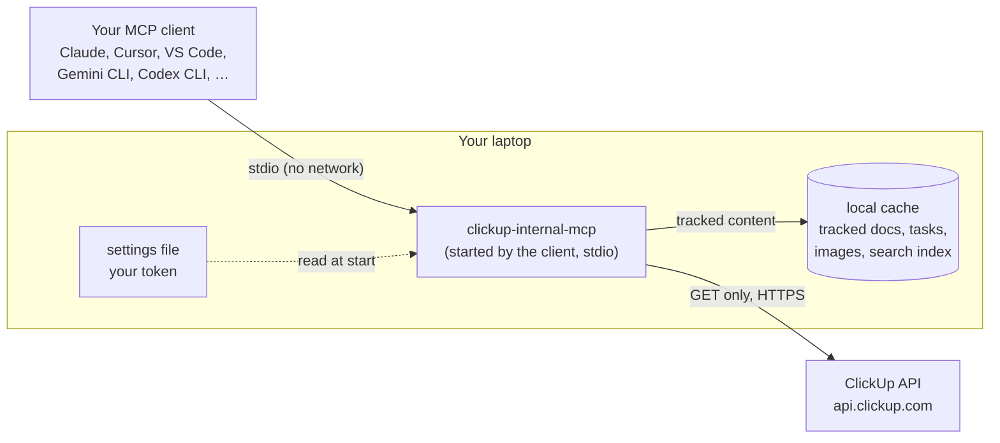

# clickup-internal-mcp

**English** | [Bahasa Indonesia](README.id.md)

A read-only [MCP](https://modelcontextprotocol.io) server that lets your AI assistant read a
**ClickUp workspace through your own personal token**, for when the official ClickUp MCP is not
available to you. It works with any MCP client that starts local servers: Claude Desktop, Claude
Code, Cursor, Windsurf, VS Code (Copilot), Gemini CLI, Codex CLI and others. It was built first for
**gathering requirements** from ClickUp Docs and tasks, and is general enough for any ClickUp lookup.



**How it works, in plain words:**

1. **You ask your assistant**, for example "read this doc and list the requirements", with a
   ClickUp link pasted in. The assistant calls clickup-internal-mcp.
2. **The server runs on your own laptop.** Your MCP client starts it as a small background program
   and talks to it directly; nothing is opened to the network on your side.
3. **The server asks ClickUp with your own token**, so it sees exactly what you can see in ClickUp,
   nothing more. It only ever *reads*: there is no code in it that can create, change or delete
   anything in ClickUp.
4. **What you choose to track is kept on your laptop**, in a small local database with a search
   index, so the next question is answered in milliseconds without asking ClickUp again, and you can
   see what changed since last week. What you do not track is read live and forgotten after a few
   minutes.
5. **Mockups and diagrams are handled too.** Images in a tracked doc are downloaded once. The
   assistant looks at each image once and saves a short description, so later reads stay text-only
   and cheap.

- **Built for requirements.** Read a doc page by page with its images and embeds listed, pull tasks
  with their acceptance criteria, custom fields and comments, search everything you track, and see
  what changed in the requirements since your last look.
- **Read-only toward ClickUp, by construction.** The only code that talks to ClickUp sends `GET`
  requests. Your token goes to ClickUp's own hosts and nowhere else.
- **Fast.** A cached page reads in about 2 ms, a search over 2,000 pages in about 7 ms (measured,
  see [How Fast](#how-fast)). Live reads cost what ClickUp costs, usually 100–500 ms.
- **Quiet.** At most 8 requests at a time and 300 a minute by default, far below ClickUp's limits,
  so your token's activity looks like a person reading, not a crawler.
- **Small answers.** Every answer has a character budget and steps down in detail before anything
  is cut, with a cursor for the rest.
- **Minimal data on disk.** Only what you track is stored, in your user folder, and one command
  deletes it all.

## Contents

- [Tools](#tools)
- [How Fast](#how-fast)
- [Quick Start](#quick-start)
- [For Teammates Who Do Not Write Code](#for-teammates-who-do-not-write-code)
- [Connect Your MCP Client](#connect-your-mcp-client)
- [Gathering Requirements](#gathering-requirements)
- [Configuration](#configuration)
- [Data and Privacy](#data-and-privacy)
- [Security Model](#security-model)
- [Commands](#commands)
- [Troubleshooting](#troubleshooting)
- [Limits](#limits)
- [Development](#development)
- [Versioning](#versioning)
- [Tips](#tips)

## Tools

Nine tools. Answers are plain text, and every line starts with a reference you can pass to the next
tool. Every tool also accepts ClickUp URLs from any `*.clickup.com` host (company hosts such as
`yourcompany.clickup.com` included), so a pasted link needs no browsing.

| Tool | Use it to | Example input |
| ---- | --------- | ------------- |
| `browse` | Walk the workspace: spaces, then a space's folders, lists and docs; a folder's or list's content. | `{"target": "space:90180123456"}` |
| `read_doc` | Read a doc: the page outline, one page, or every page, as Markdown. Images appear with their saved note; Figma, whiteboard and other embeds are listed. | `{"doc": "https://app.clickup.com/9018…/v/dc/8cdu22c-13133/8cdu22c-4321"}` |
| `read_task` | Read one task in full: status, people, dates, description, custom fields, subtasks, attachments and comments. | `{"task": "task:ABC-123"}` |
| `list_tasks` | List the tasks of a list, folder or space; filter by status, assignee (`me`), tag, last update and due date. | `{"in": "list:901812345678", "assignee": "me", "updated_since": "7d"}` |
| `search` | Find words across everything you track: doc pages, tasks and comments, ranked with titles first. | `{"query": "checkout shipping", "kinds": ["docs"]}` |
| `track` | Choose what is kept locally: add, remove, list or sync a doc, list, folder or space. | `{"action": "add", "target": "https://app.clickup.com/9018…/v/dc/8cdu22c-13133"}` |
| `changes` | See what changed in tracked content since your last look or a date: page diffs and task events. | `{"since": "7d"}` |
| `view_image` | Show one image (a mockup, a diagram) to the assistant. | `{"image": "img:3f2a9c1b7d4e"}` |
| `note_image` | Save the assistant's description of an image; later reads print it instead of the image. | `{"image": "img:3f2a9c1b7d4e", "note": "Checkout form: …"}` |

`track` and `note_image` write to the local cache only; nothing changes in ClickUp.

A requirements session often looks like this:

```text
You:        Read https://app.clickup.com/…/v/dc/8cdu22c-13133 and list the requirements.
Assistant → read_doc {"doc": "https://app.clickup.com/…/v/dc/8cdu22c-13133"}
            Doc: Checkout Requirements (doc:8cdu22c-13133) · live read · by bob · updated 5h ago · 6 pages
            Pages:
              doc:8cdu22c-13133/page:8cdu22c-4321  Overview (2,140 chars, 1 image)
              doc:8cdu22c-13133/page:8cdu22c-4322  Limits (860 chars)
              …
You:        Track it, and describe the mockups.
Assistant → track {"action": "add", "target": "doc:8cdu22c-13133"}
            Synced: 1 doc, 0 page changes, 0 tasks updated, 4 images.
Assistant → view_image {"image": "img:3f2a9c1b7d4e"}  →  note_image {…}
You:        Which acceptance criteria are missing from the tasks in Sprint 42?
Assistant → list_tasks {"in": "list:901812345678"}  →  read_task {"task": "task:ABC-123"}  →  …
Next week:  What changed in the requirements?
Assistant → changes {}
            Docs:
              doc:8cdu22c-13133/page:8cdu22c-4322  Checkout Requirements › Limits · changed 2d ago (+3 −1)
                - Maksimal 10 barang per pesanan pelanggan.
                + Maksimal 20 barang per pesanan pelanggan.
```

What each tool returns, with every argument: [docs/tools.md](docs/tools.md).

## How Fast

Measured with `bun run bench` on an Apple silicon laptop (Bun 1.4.4), through a real MCP client and
server, against a fake ClickUp API (so ClickUp's own latency is not included). Full table:
[docs/benchmarks.md](docs/benchmarks.md).

| Case | 2,000-page doc, p95 | 10,000-page doc, p95 |
| ---- | ------------------- | -------------------- |
| `read_doc` one page from the cache | 2.0 ms | 7.7 ms |
| `read_doc` outline from the cache | 3.6 ms | 14.3 ms |
| `search`, two words | 7.5 ms | 50.9 ms |
| First sync of the whole doc | 251 ms | 5.4 s |

A live read adds ClickUp's own time, typically 100–500 ms per call; repeated reads within a few
minutes come from memory.

## Quick Start

### 1. Prerequisites

|  | Mac | Windows |
| - | --- | ------- |
| Runtime | [Bun](https://bun.sh) 1.4.4+: `brew install oven-sh/bun/bun` | Bun (`powershell -c "irm bun.sh/install.ps1 \| iex"`), or **Node.js 22.18+** where Bun is not allowed |
| No runtime allowed? | Use the [single-file executable](#for-teammates-who-do-not-write-code) | Use the [single-file executable](#for-teammates-who-do-not-write-code) |
| An MCP client | Any client in [Connect Your MCP Client](#connect-your-mcp-client) | The same |

SQLite comes with the runtime (`bun:sqlite` or `node:sqlite`). There is nothing to compile and no
native module to install.

### 2. Create Your ClickUp Token

ClickUp → **Settings → Apps → API tokens → Create token**. Name it `clickup-mcp`, so you know which
one to revoke later. The token works as you: it sees what your account sees. Never share it, never
commit it, and never paste it into a chat.

### 3. Install and Configure

```bash
git clone https://github.com/adhibuchori/clickup-internal-mcp.git
cd clickup-internal-mcp
bun install
cp .env.example .env
```

Open `.env` and fill in two values:

```bash
CLICKUP_API_TOKEN=pk_…            # the token from step 2
CLICKUP_WORKSPACE_ID=1234567890   # the number right after the host in any ClickUp URL
```

The workspace id is in every ClickUp URL: `https://app.clickup.com/<workspace id>/…`.

### 4. Check

```bash
bun run doctor
```

```text
clickup-internal-mcp 0.2.0
ok    Token      accepted for your-name (token …a1b2)
ok    Workspace  workspace 1234567890 reachable, 12 spaces visible
ok    Cache      /Users/you/Library/Application Support/clickup-internal-mcp (0 tracked)
ok    Mirror     off (set CLICKUP_MIRROR_DIR to write Markdown files)
ok    Time zone  Asia/Jakarta
```

The token is only ever shown as its last four characters.

### 5. Connect Your Client

```bash
bun run setup                       # every client
bun run setup -- --client cursor    # one client
```

Paste the snippet where it says, restart the client, and ask it to "browse ClickUp". Details per
client: [Connect Your MCP Client](#connect-your-mcp-client).

## For Teammates Who Do Not Write Code

`bun run build` makes single-file executables in `dist/` that need neither Bun nor Node:
`clickup-internal-mcp-windows-x64.exe`, `-darwin-arm64` (Apple silicon), `-darwin-x64` (Intel Mac)
and `-linux-x64`. Releases attach them ([RELEASING.md](RELEASING.md)). A teammate then:

1. puts the executable in a folder of its own, e.g. `C:\Tools\clickup-mcp\`;
2. creates **their own** token (step 2 above) and a settings file named
   `clickup-internal-mcp.env` beside the executable, with `CLICKUP_API_TOKEN` and
   `CLICKUP_WORKSPACE_ID` (in Notepad, save as "All files" so it does not become `.env.txt`);
3. runs `<executable> doctor` in a terminal in that folder;
4. runs `<executable> setup --client <their app>` and pastes the snippet into their app.

On a Mac, allow the executable once: right-click → Open, or
`xattr -d com.apple.quarantine <file>`. The full walkthrough, Windows and Mac:
[docs/clients.md](docs/clients.md#for-a-teammate-who-does-not-write-code). Tokens are never shared;
each person revokes their own.

## Connect Your MCP Client

The server speaks standard MCP over stdio, and its tools and instructions are written for any model.
`setup` prints the exact snippet for your machine, with absolute paths (apps started from the Dock
on a Mac do not see your terminal's PATH) and **without the token** (the server reads it from its
own settings file, so it never sits in a client's config, and clients that filter `*TOKEN*`
variables cannot drop it).

| Client | `--client` | Where the snippet goes |
| ------ | ---------- | ---------------------- |
| Claude Desktop | `claude-desktop` | Settings → Developer → Edit Config, under `mcpServers` |
| Claude Code | `claude-code` | a `claude mcp add … --scope user` command |
| Cursor | `cursor` | `~/.cursor/mcp.json`, under `mcpServers` |
| Windsurf | `windsurf` | `~/.codeium/windsurf/mcp_config.json`, under `mcpServers` |
| VS Code (Copilot Chat, agent mode) | `vscode` | "MCP: Open User Configuration", under `servers`, with `"type": "stdio"` |
| Gemini CLI | `gemini-cli` | `~/.gemini/settings.json`, under `mcpServers` |
| Codex CLI | `codex-cli` | `~/.codex/config.toml`, as `[mcp_servers.clickup-internal]` |
| Anything else with stdio MCP | `other` | command = the printed path, no arguments, no environment |

`view_image` returns the image as MCP image content. A client that does not show images from tools
still gets the text and every saved note. Web apps (claude.ai in the browser, ChatGPT, ClickUp Brain)
only connect to remote servers and are [not supported](#limits). More: [docs/clients.md](docs/clients.md).

## Gathering Requirements

A workflow that works well:

1. **Start from a link.** Paste the doc URL: *"Read this doc and list every requirement with its
   page reference."* For a long doc the assistant reads the outline first, then page by page.
2. **Track what you will come back to.** *"Track this doc"* (or the list or folder of the project).
   Its pages, images, tasks and comments are cached and searchable, and changes are recorded from
   now on. Keep scopes narrow: the doc or list the work needs, not a whole space.
3. **Describe the mockups once.** *"Describe every image that has no note yet."* The assistant opens
   each with `view_image` and saves what it shows with `note_image`: the screen, its fields and
   labels, buttons and actions, states (empty, error, loading) and any text in the image. Every later
   read prints the note in place of the image. `track list` says how many images still lack a note.
4. **Ask for structure.** User stories, acceptance criteria, business rules, dependencies, and
   **open questions**, each with its reference (`doc:…/page:…`, `task:…`). Ask explicitly for
   mismatches between the text and the mockups, and between the doc and the tasks: a field in a
   mockup that no requirement mentions is a typical open question.
5. **Cross-check the tasks.** *"For every task in list:…, check its acceptance criteria against the
   doc."* `list_tasks` plus `read_task` cover it; `search` finds where a term is used.
6. **Follow the changes.** *"What changed in the requirements since last week?"* `changes` shows
   page diffs and task events (status, assignees, priority, description) since your last look or a
   date.

Figma files and ClickUp whiteboards are listed as links (`read_doc` ends with "Linked content not
readable as text here"). Export what matters as an image into the doc, or describe it in a comment.

## Configuration

All settings come from the environment or from a settings file, the environment winning. The
server reads the first settings file it finds:

1. the file named by `CLICKUP_ENV_FILE`;
2. `.env` in the checkout (next to `package.json`);
3. `.env` or `clickup-internal-mcp.env` beside a compiled executable;
4. `.env` in the data folder.

See [`.env.example`](.env.example).

| Setting | Default | Meaning |
| ------- | ------- | ------- |
| `CLICKUP_API_TOKEN` | required | Your personal token. Never shown, logged or sent anywhere but ClickUp. |
| `CLICKUP_WORKSPACE_ID` | required | The number after the host in any ClickUp URL. |
| `CLICKUP_DATA_DIR` | per OS, below | Where the cache lives. |
| `CLICKUP_MIRROR_DIR` | off | Also write tracked docs as Markdown files, with their images, to this folder. |
| `CLICKUP_CACHE_TTL_DAYS` | `30` | Page revisions and task events older than this are dropped (the newest revision of every page is kept). |
| `CLICKUP_MAX_CONCURRENCY` | `8` | Requests to ClickUp in flight (1–16). |
| `CLICKUP_MAX_RPM` | `300` | Requests to ClickUp per rolling minute (10–5,000). |
| `CLICKUP_ASSET_HOSTS` | none | Extra host suffixes images may be downloaded from, comma-separated. ClickUp's own hosts are always allowed; the token is never sent to an added host. |
| `CLICKUP_TIMEZONE` | the system's | Time zone for dates. Due dates are local days, so this matters: `2026-11-04` in Jakarta is `2026-11-03` in UTC. |
| `LOG_LEVEL` | `info` | `debug`, `info`, `warn` or `error`. See [Reading the Logs](#reading-the-logs). |

**The cache** lives in the data folder: `~/Library/Application Support/clickup-internal-mcp` on
macOS, `%LOCALAPPDATA%\clickup-internal-mcp` on Windows, `~/.local/share/clickup-internal-mcp`
elsewhere. It holds `store.db` (SQLite with a full-text index) and `assets/` (images, named by the
hash of their content). Delete it any time with `purge --yes`; tracking again rebuilds it. When a new
version changes the cache layout, the content is dropped and synced again on the next read, and the
list of what you track is kept.

**What is fresh when:**

- Tracked docs are re-synced before a read when the last sync is older than 30 minutes, or right
  away with `fresh: true`. A sync costs two calls per doc; unchanged pages cost nothing more.
- Tasks are always read live (status changes during the day) and kept in memory for one minute.
- Tracked tasks sync incrementally: only tasks updated since the last sync are fetched.
- `browse` answers are kept in memory for ten minutes.
- `changes` syncs every scope older than ten minutes first.

## Data and Privacy

- **What is stored:** only scopes you track (pages, tasks, comments, images, image notes), plus the
  names of workspace members (to show who wrote a doc). Everything else is read live and kept in
  memory for at most a few minutes.
- **Where:** the data folder above, created with owner-only permissions. Encryption at rest relies
  on FileVault or BitLocker.
- **How to remove it:** `track` with `remove` deletes one scope, its images and its mirror files;
  `purge --yes` deletes everything.
- **Sent where:** only to `api.clickup.com` and ClickUp's attachment hosts. No telemetry. What the
  assistant reads goes to its AI provider as part of your conversation, like anything else you share
  there.
- **Redaction:** tokens, keys, passwords and credentials that people pasted into docs or comments
  are masked in every answer.
- **Optional mirror:** with `CLICKUP_MIRROR_DIR`, tracked docs are also written as Markdown files
  (front matter with the source URL and reference, images copied beside them), for reading or
  `git diff` outside the assistant. Keep that folder out of any shared or synced location.

## Security Model

- **Read-only toward ClickUp.** `src/adapters/clickup/http-client.ts` is the only code that talks to
  ClickUp, and it sends `GET` only, with redirects refused. The port the rest of the code uses has no
  method that changes anything.
- **The token stays home.** It is read from your settings file, sent only to ClickUp's hosts, never
  logged, never named in an error, and masked if it ever appears in content.
- **Downloads are fenced.** Images come only over HTTPS from ClickUp's attachment hosts (plus
  `CLICKUP_ASSET_HOSTS`), every redirect is checked again, files are capped at 25 MB, and the image
  type is read from the bytes, not trusted from the server.
- **Nothing outside its folders.** File names in the data and mirror folders are validated, so the
  server cannot write anywhere else.
- **Untrusted content.** Docs, tasks and comments are written by other people and may contain text
  aimed at the model. The server instructions tell the model it is data; and even a persuaded model
  cannot change ClickUp through these tools.
- **Quiet traffic.** The limiter and the retry rules (a 429 waits for ClickUp's reset time) keep the
  token well inside ClickUp's limits.

Reporting a vulnerability: [SECURITY.md](SECURITY.md). Threat model:
[.claude/rules/security/read-only.md](.claude/rules/security/read-only.md).

## Commands

From a checkout, `bun run <command>`; with an executable, `<executable> <command>`.

| Command | What it does |
| ------- | ------------ |
| (none), or `bun start` | Run the MCP server on stdin/stdout. Your MCP client does this; you rarely need to. |
| `setup [--client <id>]` | Print the config snippet for each client (or one), with this machine's paths. Works before any token is set. |
| `doctor` | Check the token, the workspace, the cache, the mirror and the time zone. |
| `version` | Print the version. |
| `purge --yes` | Delete the local cache. ClickUp is not touched. |
| `bun run spike -- --doc <id>` | Check the real API's response shapes for a doc (prints shapes only, never content). |
| `bun run build [-- <target>…]` | Build single-file executables in `dist/`. |
| `bun run bench [-- <pages>]` | Measure cached reads and search against the fake API. |

## Troubleshooting

| Symptom | Fix |
| ------- | --- |
| `clickup-internal-mcp is not configured: CLICKUP_API_TOKEN is missing` | The settings file was not found or is empty. `setup` says where to put it; with an executable, put `clickup-internal-mcp.env` beside it. |
| `ClickUp rejected the token.` | The token was revoked or mistyped. Create a new one and run `doctor`. |
| `doctor`: `Workspace … CLICKUP_WORKSPACE_ID` | The id is wrong: copy the number right after the host in a ClickUp URL. |
| The client shows the server as failed, or "command not found" | Run `setup` again and paste the new snippet: the command must be an absolute path. On a Mac, allow the executable once (right-click → Open). |
| `Your ClickUp account cannot open this doc.` | Your account has no access in ClickUp. Ask the owner to share it with you. |
| `No doc with that id in this workspace.` | Copy the URL from the browser and pass it as is; check `CLICKUP_WORKSPACE_ID`. |
| `ClickUp is rate limiting this token.` | Wait a minute. Lower `CLICKUP_MAX_RPM` if it keeps happening. |
| `ClickUp could not be reached` | Network or VPN. Tracked content is still served from the cache, with a note. |
| `search` says nothing is tracked | `search` only covers tracked content; `track` the doc, list or folder first. |
| `track` says the sync continues in the background | A big scope. `track` with `list` shows when it is done; reads work meanwhile. |
| An image line says "not downloaded" | The doc is not tracked. `view_image` with the printed URL downloads it, or track the doc. |
| `view_image` shows text but no image | Your client does not display images from tools. Describe images from a client that does. |
| Dates are a day off | Set `CLICKUP_TIMEZONE`, e.g. `Asia/Jakarta`. |

### Reading the Logs

The server writes one line per event to stderr, which your MCP client shows in its log for this
server: `[time] LEVEL message key=value …`. Logs stay on your machine; nothing is sent anywhere.
`LOG_LEVEL` sets how much you see:

- `info` (default): start-up, and every tool call with its time and answer size.
- `debug`: also one line per ClickUp request, with its path, status and time.
- `warn` or `error`: problems only: retries, images skipped, background syncs that failed, tools
  that crashed.

An example, for illustration:

```text
[2026-11-02T09:00:01.120Z] INFO ready version=0.2.0 workspace=1234567890 tracked=3
[2026-11-02T09:00:14.402Z] DEBUG clickup get path=/api/v3/workspaces/1234567890/docs/8cdu22c-13133/pages status=200 ms=312
[2026-11-02T09:00:14.731Z] INFO tool tool=read_doc ms=331 chars=6120 tokens=1530 image=false
[2026-11-02T09:01:02.015Z] WARN clickup retry status=429 waitMs=5250 attempt=1
[2026-11-02T09:01:40.877Z] WARN image skipped host=t1234567890.p.clickup-attachments.com reason="ClickUp answered 404"
```

| Line | Meaning |
| ---- | ------- |
| `tool … ms= chars= tokens=` | One tool call: time spent, and the size of the answer (tokens are estimated at 4 characters each). |
| `clickup get path= status= ms=` | One request to ClickUp (`debug` only). |
| `clickup retry status= waitMs= attempt=` | ClickUp answered 429 or 5xx, or the network failed; the request is retried after `waitMs`. |
| `image skipped host= reason=` | An image in a doc could not be downloaded; the sync goes on without it. |
| `background sync failed scope= reason=` | A first sync that continued in the background failed; `track list` shows the error on the scope. |
| `tool failed tool= error=` | An internal error, with its stack. The model only got "Internal error"; please report it. |

## Limits

- ClickUp's public API has **no text search**, for docs or tasks: `search` covers tracked content
  only.
- Tasks deleted in ClickUp stay in the cache until their scope is removed.
- `read_task` shows the comments ClickUp returns in one request (the most recent ones).
- Figma files and whiteboards are listed as links, not read.
- Doc Markdown comes from ClickUp's own conversion; some embeds do not survive it.
- **Web apps are not supported.** claude.ai in the browser, ChatGPT and ClickUp Brain only connect
  to remote MCP servers over HTTPS. That needs a hosted server with authentication and moves the
  token off each person's laptop; it is a separate decision with its own security review.

## Development

```sh
clickup-internal-mcp/
├── src/
│   ├── index.ts         # CLI entry: stdio server, setup, doctor, version, purge
│   ├── env.ts           # the only reader of environment variables and settings files
│   ├── core/            # pure logic: references and URLs, Markdown images and embeds, paging,
│   │                    # diff, FTS queries, budgets, redaction, host rules, time, image sniffing
│   ├── ports/           # interfaces the engine depends on: ClickUpReader, Stores, files, logger
│   ├── adapters/        # I/O: the ClickUp HTTP client, SQLite + FTS5, image and mirror files, logger
│   ├── engine/          # application services: docs, tasks, hierarchy, sync, tracking, images,
│   │                    # search, changes, members, doctor
│   ├── tools/           # the nine MCP tools: <name>.tool.ts → engine → <domain>.format.ts
│   ├── config/          # settings validation, .env parsing, client setup snippets
│   ├── composition/     # wires adapters into the runtime (the composition root)
│   └── testing/         # the fake ClickUp API, invented fixtures, a full test runtime
├── scripts/             # build, setup, spike, bench, CI smoke tests, quality gates
└── docs/                # tools, clients, architecture, benchmarks
```

The design and the reasons behind it are in [docs/architecture.md](docs/architecture.md). The rules
an assistant follows in this repo are in [AGENTS.md](AGENTS.md).

Quality gates run on every commit (husky) and every pull request (CI on Ubuntu, macOS and Windows,
plus the Node runtime and the compiled executable):

```bash
bun run fl                   # format (oxfmt) + lint (oxlint, type-aware)
bun run type-check           # TypeScript 7, strict
bun run test:coverage        # 160 tests, 100% of lines and functions per file
bash scripts/check/gates.sh  # everything above plus comment style, dead code, folder shape, secrets, …
```

- Tests never touch the network: ClickUp is a fake with the real paths and response shapes, and
  every tool test goes through a real MCP client and server.
- Files are at most 200 lines and functions at most 40.
- Comments use `/** */` or `/* */`, never `//`.
- There is no `any`, and layers import in one direction only, which lint enforces.

See [CONTRIBUTING.md](CONTRIBUTING.md).

## Versioning

[Semantic Versioning](https://semver.org). The version in `package.json` is the one the server
reports to clients and `version` prints. Changes are listed in [CHANGELOG.md](CHANGELOG.md), and
releases are tagged `vX.Y.Z` with a GitHub Release that carries the executables; the process is in
[RELEASING.md](RELEASING.md).

## Tips

- Track narrowly: the doc or list the work needs. A whole space syncs every task in it.
- Describe images once, right after tracking a doc: every later read prints the note instead of
  opening the image again.
- Ask `changes` at the start of a planning session to see what moved in the requirements.
- If your token was ever exposed, revoke it in ClickUp, create a new one, update the settings file
  and run `doctor`.
- Updating: `git pull && bun install` in a checkout, or replace the executable (keep the settings
  file beside it). Then restart your MCP client.
